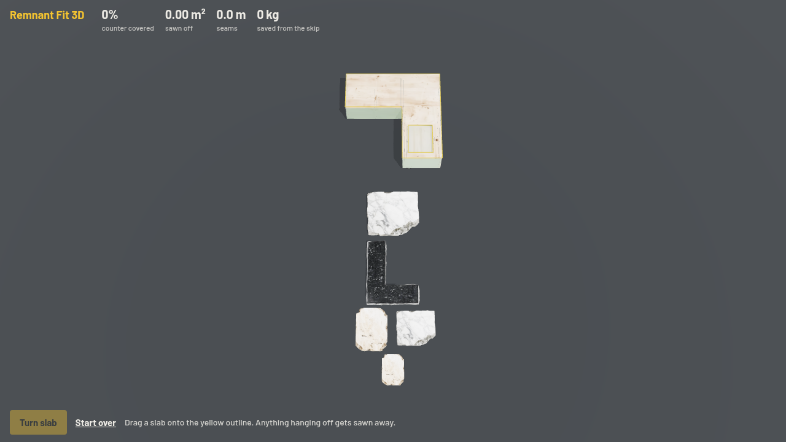

# Remnant Fit 3D

Entry for the Manycore Aholo Global 3D AI Hackathon. A browser game about a real waste problem in stone shops: offcuts get thrown away because nobody can picture them on a counter. Five kitchens, a yard of offcuts, and a foreman whose plan you try to beat.

Every kitchen and every slab is an Aholo Lux3D generation (`lux3d/gen.py`: text-to-3D, image generation, image-to-3D and material transfer; 17 tasks, every event in `lux3d/gen.log`). The game reads each level straight off the mesh: it rasterises the generated GLB from above onto a 10 cm grid, so the counter, the sink and the cooktop hole all come from the model. A greedy foreman solves each level at load time and his score is the bar for the stars.

- Play: https://remnant-fit-3d.designmaster.workers.dev (`?job=3` opens a job directly)
- `public/fit.js`: rules, scoring, foreman, grid filters · `public/mesh-grid.js`: reads levels from meshes · `public/levels.js`: the five jobs
- `public/game.js` three.js scene · `public/ui.js` HUD and cards · `public/audio.js` synthesised sound
- Tests: `npm test` (node, loads the real GLBs); `?selftest` runs a touch test inside the page
- Film: `video/build.sh`, HyperFrames render with `video/director.js`, `video/record.mjs`, then `video/finish.py`
- Report: `public/report/` · Deploy: `npx wrangler deploy`
